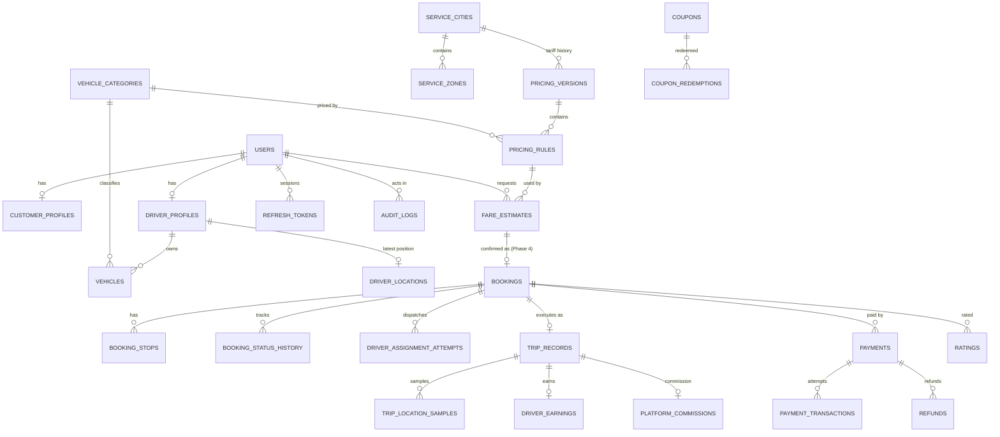
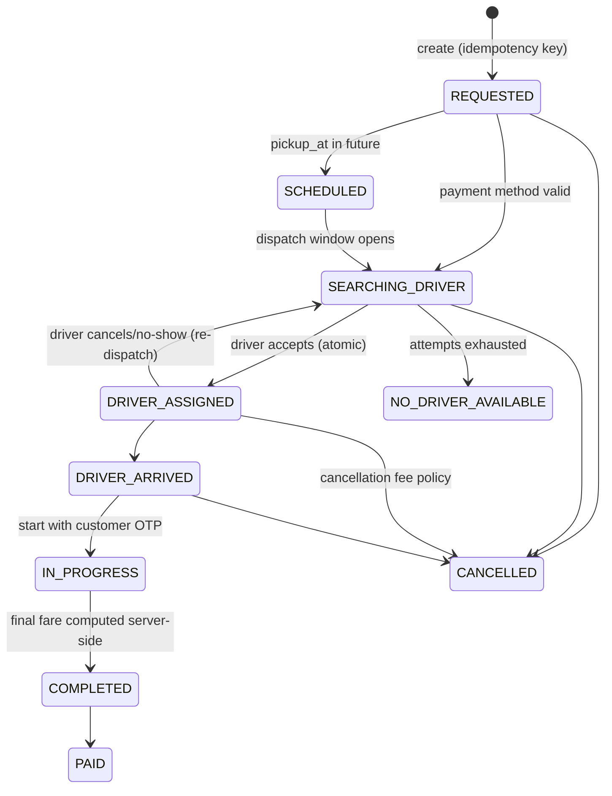

# SwiftCab — Architecture

Original-brand taxi booking platform (modular monolith, monorepo). **Status: Phase 1–3 backend slice implemented; apps not yet built — see README "Status".**

## Monorepo layout

```
apps/api        NestJS + TypeORM API (REST /api/v1, Swagger at /api/docs)   [implemented: foundation slice]
apps/admin      Next.js admin dashboard                                     [NOT started]
apps/customer   Expo (React Native) customer app                            [NOT started]
apps/driver     Expo (React Native) driver app                              [NOT started]
packages/*      shared types / API client (planned)
docs/           this document
```

## Runtime components

| Component | Dev (this repo, no Docker) | Production |
|---|---|---|
| Database | `pg-mem` in-process Postgres emulation (`DB_MODE=memory`) | PostgreSQL (`DB_MODE=postgres`, `DATABASE_URL`) |
| Cache / ephemeral dispatch state | not yet used | Redis (planned for Phase 4: ride-request TTL state) |
| Geocoding | mock gazetteer (Chennai landmarks) or Nominatim | Google Places/Maps or self-hosted Nominatim/Pelias |
| Routing | mock (labelled `mock_estimate`) or OSRM public demo | Google Directions/Routes or self-hosted OSRM |
| OTP/SMS | `DEV_MOCK` — OTP returned in API response, labelled | provider implementing `SmsProvider` (`OTP_MODE=sms`) |

`pg-mem` is an emulator: passing tests there does not prove behaviour on real PostgreSQL (e.g. locking, `numeric` semantics, migrations). Run the suite against real Postgres before release.

## Key design decisions

- **Fare engine** (`apps/api/src/fares/fare-engine.ts`): pure function, `decimal.js`, no I/O. Same code for estimates and final billing. Money stored as `numeric(12,2)` and handled as strings. Rounding: half-up to 2 dp per line. Minimum fare is a **floor** on the pre-tax fare (never additive). Tolls/parking are untaxed pass-through. Discount cannot exceed subtotal. Demand multiplier is capped by `maxSurgeMultiplier`.
- **Pricing versions**: tariffs are immutable, effective-dated `pricing_versions` (per city) with `pricing_rules` (per category + trip type) holding the config JSON. Admin edits create a new version and close the previous one; estimates (and later bookings) store `pricing_version_id`/`pricing_rule_id` instead of copying rules per booking.
- **Never trust the client for money**: DTOs use `whitelist + forbidNonWhitelisted`; estimate endpoints take only locations/time.
- **Route-based distance**: fares use the routing provider’s road distance. If routing fails the API returns `502 ROUTE_UNAVAILABLE` / `422 NO_ROUTE` — no invented distance. The mock provider is flagged `isEstimate: true`.
- **Auth**: OTP (hashed, 5 min TTL, 5 attempts, 30 s resend gap, single-use) → 15 min JWT access token + opaque refresh token (hashed, rotated on use; replay revokes the token family). Global `AuthGuard` + `@Roles()`; roles come from the signed token. Self-signup can only create `customer` / `driver`.
- **Rate limiting**: global throttler + stricter per-route limits on OTP/refresh/estimate.
- **Timezones**: timestamps are `timestamptz` (UTC); night/peak rules are evaluated in the city’s IANA timezone.

## Roles

`customer`, `driver`, `admin`, `ops_manager`, `support_agent`. Current enforcement: staff routes require any staff role; pricing/category writes require `admin`/`ops_manager`; audit logs `admin` only.

## Entity relationships (implemented subset marked ✅)



✅ Implemented now: `users, customer_profiles, driver_profiles, vehicles, vehicle_categories, service_cities, service_zones, driver_locations, pricing_versions, pricing_rules, fare_estimates, otp_codes, refresh_tokens, audit_logs`.
Not yet: bookings & downstream, payments, coupons, ratings, notifications, support, emergency contacts, driver documents, admin_roles/permissions tables (roles are currently an enum on `users`).

## Booking state machine (to implement in Phase 4)



Fare policies already implemented in the engine: cancellation fee (free before assignment or within grace window; capped at estimate; never for driver-initiated cancels). Route-change, extra-stop and dispute policies are specified in the engine inputs (`extraStops`, `waitingMinutes`) but dispute workflow is not built.

## Dispatch (to implement in Phase 4)

Simple, testable first version: radius search (already used for availability), filter by category/approval/online/not on trip, offer to the N nearest in batches with a response timeout, next batch on reject/timeout, atomic accept (`UPDATE … WHERE status='SEARCHING_DRIVER'`) to prevent double assignment. Redis holds offer TTLs. Extensible to scoring (rating, acceptance rate).
