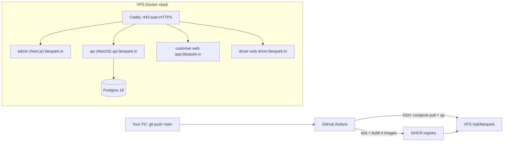

# LiteSpark Taxi – VPS Deployment Guide (Git + Docker + GitHub Actions)

## Architecture



| Subdomain | Service |
|---|---|
| `litespark.in`, `www.` | Public site, Razorpay policy pages, `/admin` |
| `api.litespark.in` | NestJS API |
| `app.litespark.in` | Customer Flutter web |
| `driver.litespark.in` | Driver Flutter web |

Replace `litespark.in` everywhere with your real domain.

## Files added to the repo

| File | Purpose |
|---|---|
| `apps/api/Dockerfile` | API image |
| `apps/admin/Dockerfile` | Next.js image (API URL baked at build) |
| `docker/flutter-web.Dockerfile` + `docker/nginx-spa.conf` | Builds both Flutter web apps → nginx |
| `deploy/docker-compose.prod.yml` | Production stack (Postgres, API, admin, customer, driver, Caddy) |
| `deploy/Caddyfile` | Reverse proxy + free auto HTTPS |
| `deploy/.env.example`, `deploy/.env.api.example` | Templates for VPS secrets |
| `.github/workflows/deploy.yml` | Test → build → push → deploy on every push to `main` |
| `.dockerignore`, `.gitignore` | Updated |

---

## Step 1 – Buy VPS & domain
- VPS: Ubuntu 24.04, **min 2 vCPU / 4 GB RAM** (Hetzner, DigitalOcean, Hostinger, AWS Lightsail Mumbai).
- Domain: e.g. from GoDaddy / Namecheap / Hostinger.

## Step 2 – DNS records (at your domain provider)
Add **A records** pointing to the VPS IP:

| Type | Name | Value |
|---|---|---|
| A | `@` | VPS_IP |
| A | `www` | VPS_IP |
| A | `api` | VPS_IP |
| A | `app` | VPS_IP |
| A | `driver` | VPS_IP |

## Step 3 – Prepare the VPS (SSH in as root once)
```bash
ssh root@VPS_IP

# Updates + firewall
apt update && apt upgrade -y
ufw allow OpenSSH && ufw allow 80 && ufw allow 443 && ufw --force enable

# Docker
curl -fsSL https://get.docker.com | sh

# Deploy user (no password login)
adduser --disabled-password --gecos "" deploy
usermod -aG docker deploy
mkdir -p /opt/litespark && chown deploy:deploy /opt/litespark
```

## Step 4 – SSH key for GitHub Actions (on your PC)
```powershell
ssh-keygen -t ed25519 -f $HOME\.ssh\litespark_deploy -N '""'
Get-Content $HOME\.ssh\litespark_deploy.pub   # copy this line
```
On the VPS:
```bash
mkdir -p /home/deploy/.ssh
echo "PASTE_PUBLIC_KEY_HERE" >> /home/deploy/.ssh/authorized_keys
chown -R deploy:deploy /home/deploy/.ssh && chmod 700 /home/deploy/.ssh && chmod 600 /home/deploy/.ssh/authorized_keys
```
Test from your PC: `ssh -i $HOME\.ssh\litespark_deploy deploy@VPS_IP`

## Step 5 – Create env files on the VPS (as `deploy`)
```bash
cd /opt/litespark
nano .env        # paste deploy/.env.example, fill values
nano .env.api    # paste deploy/.env.api.example, fill values
chmod 600 .env .env.api
openssl rand -hex 24   # use for POSTGRES_PASSWORD
openssl rand -hex 32   # use for JWT_SECRET
```
`IMAGE_PREFIX` must be **lowercase**: `ghcr.io/<github-username>/<repo-name>`.

## Step 6 – Push code to GitHub (on your PC)
1. Create a **private** repo on GitHub, e.g. `booktaxi`.
2. ```powershell
   cd d:\booktaxi
   git add .
   git status          # make sure NO .env files are listed
   git commit -m "Initial commit: LiteSpark platform + deployment"
   git branch -M main
   git remote add origin https://github.com/<you>/booktaxi.git
   ```
   ⚠️ Don't push yet — add secrets first (Step 7), otherwise the first run fails.

## Step 7 – GitHub repo settings
**Settings → Secrets and variables → Actions**

Secrets:
| Name | Value |
|---|---|
| `VPS_HOST` | VPS IP |
| `VPS_USER` | `deploy` |
| `VPS_SSH_KEY` | full content of `litespark_deploy` (private key) |
| `VPS_PORT` | `22` (optional) |
| `GHCR_READ_TOKEN` | Personal Access Token (classic) with **`read:packages`** scope |

Variables tab:
| Name | Value |
|---|---|
| `DOMAIN` | `litespark.in` |

Also: **Settings → Environments → New environment → `production`** (optionally add yourself as required reviewer for manual approval).

## Step 8 – Deploy
```powershell
git push -u origin main
```
Watch **Actions** tab: `test-api` → `build` (4 images, Flutter takes ~8–12 min first time) → `deploy`.

## Step 9 – Verify
- https://api.litespark.in/api/v1/health
- https://litespark.in (public site + `/privacy-policy`, `/terms-and-conditions`, `/refund-policy`, `/contact`)
- https://app.litespark.in (customer) · https://driver.litespark.in (driver)

On VPS: `cd /opt/litespark && docker compose -f docker-compose.prod.yml ps` and `... logs -f api`.

## Step 10 – Daily workflow
```powershell
git add . ; git commit -m "feat: ..." ; git push
```
Every push to `main` auto-deploys. **Rollback**: on VPS set `TAG=<old commit sha>` in `.env` then `docker compose -f docker-compose.prod.yml up -d`.

---

## Before going truly live (important)

> [!WARNING]
> - **OTP / SMS**: The API refuses `NODE_ENV=production` while `OTP_MODE=dev`. The template uses `NODE_ENV=staging` + dev OTP for testing. Integrate an SMS provider (MSG91 / Twilio / Fast2SMS) in `SMS_PROVIDER`, then switch to `NODE_ENV=production`, `OTP_MODE=sms`.
> - **Database schema**: there are no TypeORM migrations yet, so `DB_SYNCHRONIZE=true` creates tables. Generate migrations and set it to `false` before real users.
> - **Seed data** includes demo/simulated drivers – set `SEED_DEV_DATA=false` after first boot and clean demo rows.
> - **Google Maps key** is hard-coded in `apps/customer_flutter/lib/core/config.dart`. Restrict it in Google Cloud Console to HTTP referrers `https://app.litespark.in/*` (and Android package for the APK).
> - **Razorpay**: start with `rzp_test_` keys; submit `https://litespark.in` for website verification, then swap to live keys.

## Backups (cron on VPS)
```bash
crontab -e
0 2 * * * docker exec $(docker ps -qf name=postgres) pg_dump -U litespark litespark | gzip > /opt/litespark/backup-$(date +\%F).sql.gz && find /opt/litespark -name 'backup-*.sql.gz' -mtime +7 -delete
```

## Mobile APKs (later)
Build Android apps pointing to production:
```powershell
cd apps\customer_flutter; flutter build apk --release --dart-define=API_URL=https://api.litespark.in
cd ..\driver_flutter;     flutter build apk --release --dart-define=API_URL=https://api.litespark.in
```

